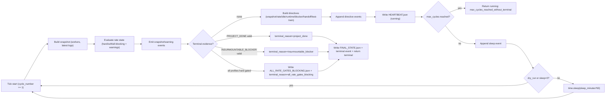

# Lane A Flow Diagrams

## Controller Tick Flow (single cycle)

## Notes

1. Locking: controller acquires `lock.pid` before loop and releases on exit/finally.
2. Tick outputs: `EVENTS.jsonl`, `HEARTBEAT.json`, and optionally `FINAL_STATE.json`.
3. Keep aligned with `skills/optimus-cycle-controller/scripts/optimus_cycle_controller.py` and `docs/plans/LANE_A_IMPLEMENTATION_STATUS.md`.
