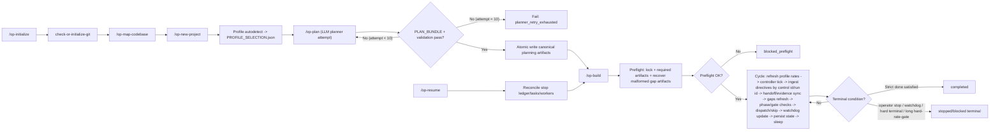
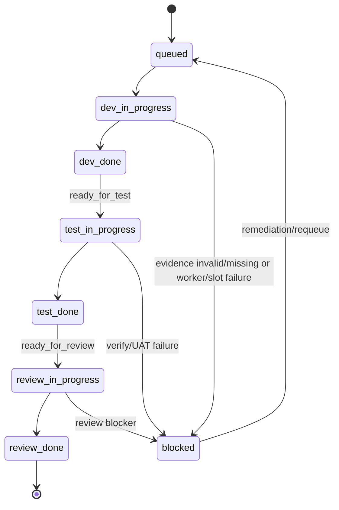

# Lane B Flow Diagrams

## Initialize/Plan/Build Control Flow

## Canonical Task Lifecycle

## Sync Contract

1. Update this file in the same PR for behavior changes touching `/op-initialize`, `/op-plan`, `/op-build`, or `/op-resume`.
2. If behavior and diagram diverge, corresponding lane status must include `diagram drift` until reconciled.
